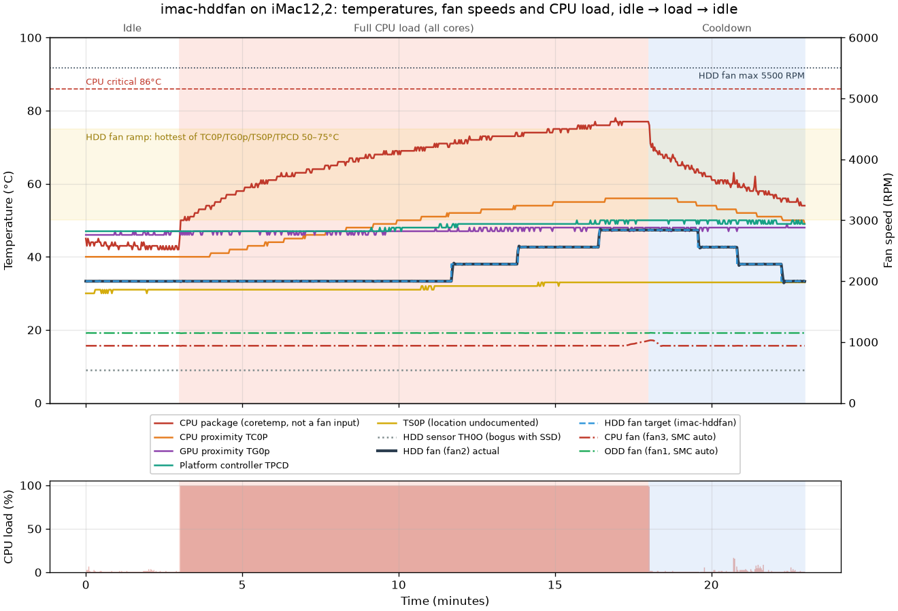

# imac-hddfan

Fan control for a 2011 iMac (iMac12,2) running Linux after its hard drive has been replaced with an SSD or a non-Apple drive.

## The problem

Apple's original hard drives have a built-in temperature sensor wired to the SMC (the chip that controls the fans). Swap in a different drive and the SMC can't read the drive temperature, so it runs the HDD fan at or near full speed (~5500 RPM).

## What this does

A small systemd service takes the HDD fan (`fan2`) into manual mode through the `applesmc` kernel driver. It then sets the speed from the hottest of the CPU, GPU and other board sensors:

| Hottest sensor | Fan speed |
|---|---|
| 50°C or below | 2000 RPM |
| 50–75°C | linear ramp |
| 75°C or above | 5500 RPM |

- Manual mode is re-applied every 5 seconds, because the SMC switches back to automatic after suspend/resume.
- Changes under 250 RPM are ignored, so the fan doesn't keep hunting.
- When the service stops, the fan goes back to SMC control.
- If none of the sensors can be found, the service exits and leaves the fan to the SMC. If a sensor read fails, that pass treats it as 75°C, so the fan runs at full speed.
- Works with both the older `applesmc` files (`fan2_manual`, `fan2_output`) and the standard hwmon ones in newer kernels (`hwmon/hwmonN/pwm2_enable`, `fan2_target`).

Tune `LOW`, `HIGH`, `T_LOW`, `T_HIGH`, `HYST` and `SENSORS` at the top of `imac-hddfan.sh`.

## Install

```
sudo ./install.sh
```

## Check it

```
S=$(echo /sys/devices/platform/applesmc.768/hwmon/hwmon*)
cat $S/pwm2_enable $S/fan2_target $S/fan2_input   # expect 1, target, actual RPM
```

On older kernels use `S=/sys/devices/platform/applesmc.768` and `fan2_manual`, `fan2_output` instead.

To list sensor names on your machine: `grep . $S/temp*_label`.

## Test run



Recorded on an iMac12,2 (i5-2500S, SSD, Fedora, kernel 7.3) with `test/fan-test.sh`: 3 minutes idle, 15 minutes with every core at 100%, then 5 minutes of cooldown. Raw data is in [`test/fan-test.csv`](test/fan-test.csv).

- **Idle:** HDD fan holds 2000 RPM. Without the service, the SMC ran it at about 3800 RPM on this machine.
- **Under load:** once the hottest control sensor passes 50°C (about 8½ minutes in), the fan steps up to 2280, 2560, then 2840 RPM. It tracks its target to within a few RPM.
- **Cooldown:** the fan steps back down and returns to 2000 RPM.
- **Temperatures:** the CPU package peaked at 78°C, 8°C under its 86°C critical limit. The control sensors sit near the chips, not on them, so they read about 20°C cooler than the CPU itself.
- Manual mode held for the whole run.

This is one 15-minute CPU-only test, not a guarantee. A heavier or longer load, a GPU load, or a hot room will run warmer, and the fan reaches full speed when a control sensor gets to 75°C. To check your own machine:

```
test/fan-test.sh fan-test.csv            # ~23 min; no root needed
python3 test/plot.py fan-test.csv fan-test.png   # needs matplotlib
```

## Other models

Other 2009–2011 iMacs have the same problem, but their fan numbers, speed limits and sensor names can differ. Check `$S/fan*_label` and `$S/temp*_label` before using this on another model.
